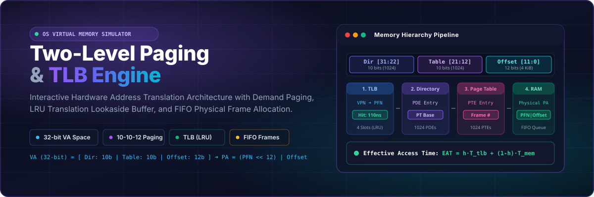
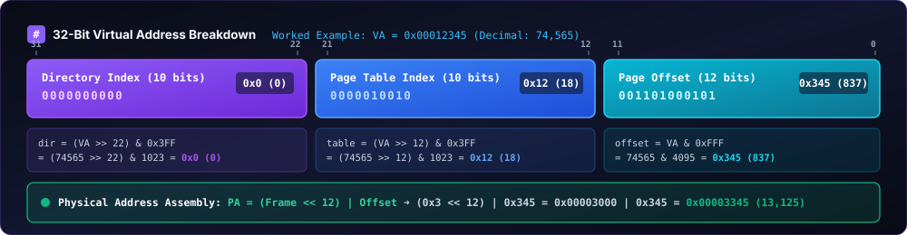
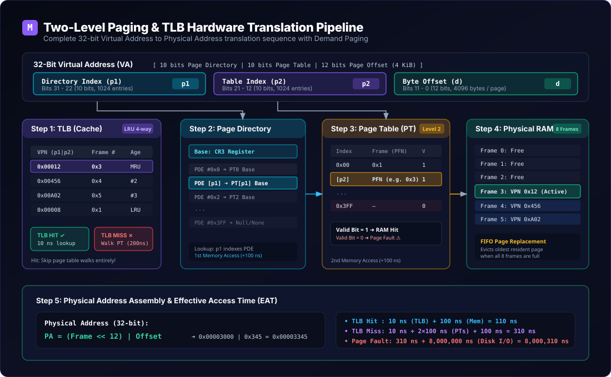
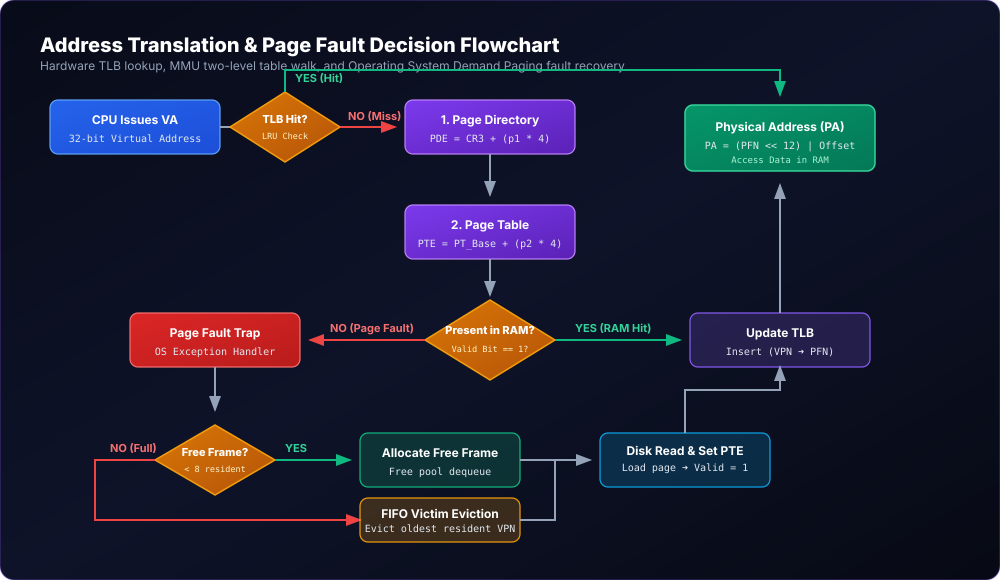
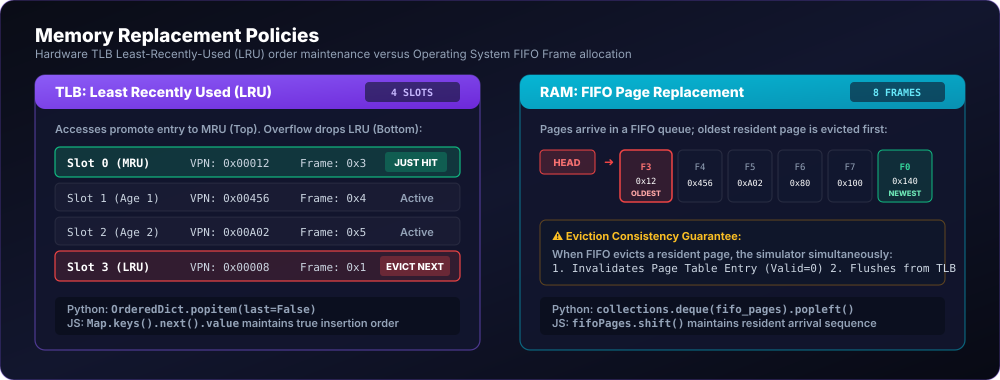
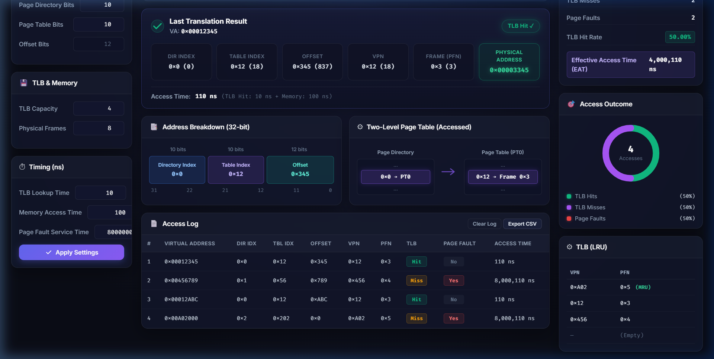
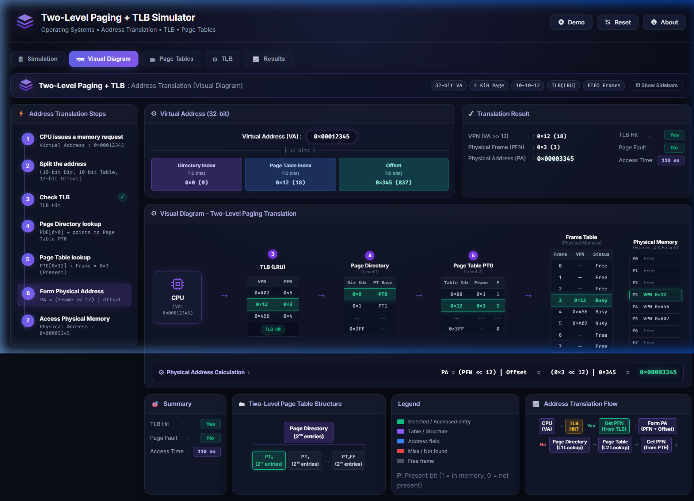
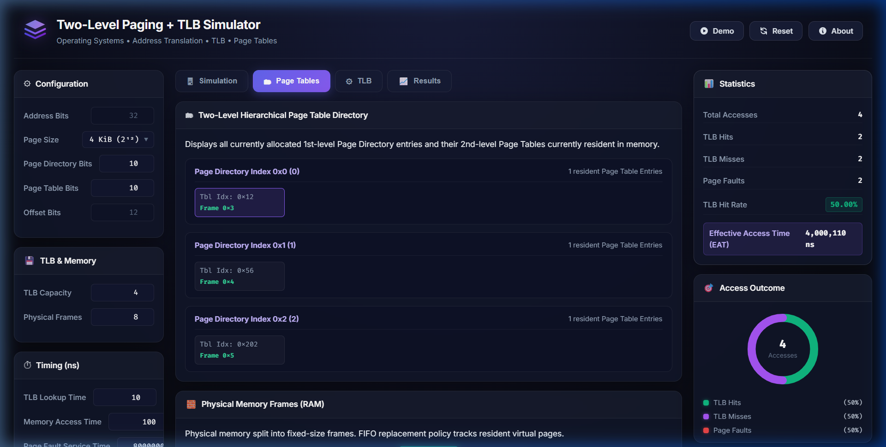
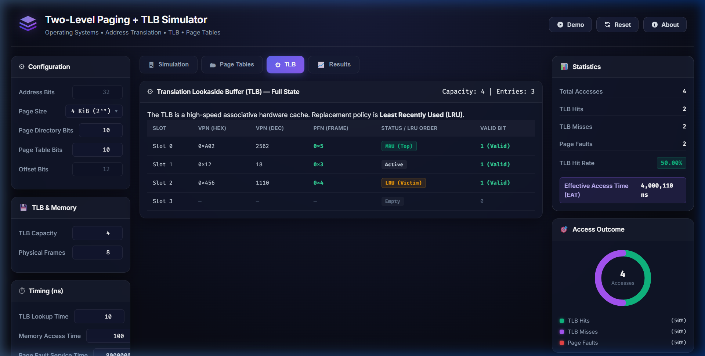
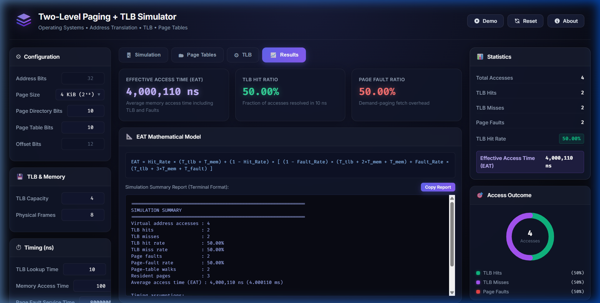

<p align="center">
  
</p>

<p align="center">
  
</p>

<p align="center">
  <a href="https://github.com/valiantProgrammer/Two-Level-Paging/blob/main/LICENSE"></a>
  
  
  
  
  
  
</p>

<p align="center">
  <a href="#-overview"><b>Overview</b></a> •
  <a href="#-key-features"><b>Features</b></a> •
  <a href="#-how-it-works"><b>Architecture</b></a> •
  <a href="#-replacement-policies"><b>Replacement Policies</b></a> •
  <a href="#-timing-and-eat"><b>Timing &amp; EAT</b></a> •
  <a href="#-quick-start"><b>Quick Start</b></a> •
  <a href="#-team--group-6"><b>Team</b></a>
</p>

<p align="center">
  
</p>

<details>
<summary><b>📑 Table of Contents (Click to expand)</b></summary>

- [1. Problem Statement](#1-problem-statement)
- [2. Overview](#2-overview)
- [3. Key Features](#3-key-features)
- [4. How It Works](#4-how-it-works)
  - [4.1 32-Bit Address Breakdown](#41-32-bit-address-breakdown)
  - [4.2 Hardware Translation Pipeline](#42-hardware-translation-pipeline)
  - [4.3 Decision Logic Flowchart](#43-decision-logic-flowchart)
  - [4.4 Step-by-Step Worked Address Walkthrough](#44-step-by-step-worked-address-walkthrough)
- [5. Replacement Policies](#5-replacement-policies)
  - [5.1 TLB Cache: Least Recently Used (LRU)](#51-tlb-cache-least-recently-used-lru)
  - [5.2 Physical RAM: First-In, First-Out (FIFO)](#52-physical-ram-first-in-first-out-fifo)
- [6. Timing and Effective Access Time (EAT)](#6-timing-and-effective-access-time-eat)
  - [6.1 Hardware Latency Parameters](#61-hardware-latency-parameters)
  - [6.2 Memory Access Paths &amp; Latencies](#62-memory-access-paths--latencies)
  - [6.3 Mathematical EAT Formulation](#63-mathematical-eat-formulation)
  - [6.4 EAT Worked Calculation Example](#64-eat-worked-calculation-example)
- [7. Web Simulator Tour](#7-web-simulator-tour)
- [8. Call History &amp; Keyboard Shortcuts](#8-call-history--keyboard-shortcuts)
- [9. Python CLI Simulator](#9-python-cli-simulator)
  - [9.1 Interactive Commands](#91-interactive-commands)
  - [9.2 Verified Sample CLI Run](#92-verified-sample-cli-run)
- [10. Quick Start](#10-quick-start)
- [11. Project Structure](#11-project-structure)
- [12. Concepts Demonstrated](#12-concepts-demonstrated)
- [13. Known Differences &amp; Future Work](#13-known-differences--future-work)
- [14. References](#14-references)
- [15. Team — Group 6](#15-team--group-6)
- [16. License](#16-license)

</details>

---

## 1. Problem Statement

> [!NOTE]
> **Assignment Specification — Operating Systems Mini-Project (Group 6):**
>
> *"Simulate address translation from virtual to physical addresses using a two-level page table and a TLB. Use bitwise operations to extract page numbers and offsets, and report TLB hit rate, page faults, and effective access time (EAT)."*

---

## 2. Overview

In modern multi-tasking operating systems, physical random-access memory (RAM) is virtualized so that each process executes within its own contiguous 32-bit address space. However, maintaining a single flat page table for a $2^{32}$ byte (4 GiB) address space with 4 KiB pages requires $2^{20} \times 4\text{ bytes} = 4\text{ MiB}$ of contiguous physical memory per process—an unacceptable overhead for embedded and general-purpose kernels.

This project delivers a complete, interactive simulation of **Hierarchical Two-Level Paging** coupled with a hardware **Translation Lookaside Buffer (TLB)**. By breaking the 20-bit virtual page number into a 10-bit Page Directory index and a 10-bit Page Table index, the OS allocates secondary page tables strictly on demand. A fast associative TLB with Least-Recently-Used (LRU) eviction accelerates frequent memory lookups, while a demand-paging engine coordinates First-In, First-Out (FIFO) physical frame allocation and page-fault resolution.

---

## 3. Key Features

| Feature | Description |
| :--- | :--- |
| ⚡ **Zero External Dependencies** | Built entirely with native Web standards (HTML5, Vanilla CSS, ES6+) and standard Python 3. |
| 🗂️ **32-Bit Hierarchical Architecture** | Implements the standard `10-10-12` address split matching classic 32-bit x86 systems. |
| 🚀 **4-Way Associative TLB (LRU)** | Features Most-Recently-Used promotion on hit and Least-Recently-Used victim eviction on full insert. |
| 🔄 **Demand Paging with FIFO Allocation** | Simulates 8 physical frames; handles cold faults, frame reclamation, and secondary table allocation. |
| ⏱️ **Rigorous Timing &amp; EAT Engine** | Computes nanosecond-scale lookups ($110\,\text{ns}$ hit, $310\,\text{ns}$ miss) and millisecond page-fault penalties. |
| 📊 **Real-Time Interactive Architecture** | Dynamic SVG hardware diagram highlights the CPU, TLB, Page Directory, Page Table, and Frame Table. |
| ⏮️ **Call History &amp; Stepper** | Full bi-directional playback (`First`, `Prev`, `Next`, `Latest`) restores historical translation states. |
| ⌨️ **Global Keyboard Navigation** | Step through past address translations instantly with `[` / `]` or `←` / `→` arrow keys. |
| 📥 **Address Batch Queue** | Queue arbitrary addresses, execute one-step increments, or run full trace sequences automatically. |
| 📈 **Live Analytics &amp; CSV Export** | Animated SVG donut chart tracking hits/misses/faults, one-click CSV export, and clipboard reporting. |

<p align="center">
  
</p>

---

## 4. How It Works

### 4.1 32-Bit Address Breakdown

A 32-bit virtual address (VA) ranges from `0x00000000` to `0xFFFFFFFF`. Under a 4 KiB page size, the address is decomposed using bitwise bitmasks and right-shifts into three dedicated segments:

<p align="center">
  
</p>

The bit extraction arithmetic is defined as follows:

$$\text{offset} = \text{VA} \ \& \ \text{0xFFF} \quad (12\text{ bits})$$

$$\text{table} = (\text{VA} \gg 12) \ \& \ \text{0x3FF} \quad (10\text{ bits})$$

$$\text{dir} = (\text{VA} \gg 22) \ \& \ \text{0x3FF} \quad (10\text{ bits})$$

$$\text{VPN} = \text{VA} \gg 12 = (\text{dir} \ll 10) \mid \text{table} \quad (20\text{ bits})$$

$$\text{PA} = (\text{frame} \ll 12) \mid \text{offset} \quad (32\text{ bits})$$

---

### 4.2 Hardware Translation Pipeline

The diagram below tracks the complete data path from the initial processor memory request through the MMU and physical RAM:

<p align="center">
  
</p>

---

### 4.3 Decision Logic Flowchart

The following flowchart outlines the hardware and operating system decision steps during every virtual address translation:

<p align="center">
  
</p>

---

### 4.4 Step-by-Step Worked Address Walkthrough

Consider a CPU memory access to virtual address **`VA = 0x00012345`** (decimal $74{,}565$):

1. **Binary Representation**:
   $$\text{VA} = \mathbf{0000\ 0000\ 0000\ 0001\ 0010\ 0011\ 0100\ 0101}_2$$
2. **Bit Splitting**:
   - **Directory Index ($p_1$)** = $\text{bits }[31:22] = 0000000000_2 = \mathbf{0x0}\ (0)$
   - **Table Index ($p_2$)** = $\text{bits }[21:12] = 0000010010_2 = \mathbf{0x12}\ (18)$
   - **Page Offset ($d$)** = $\text{bits }[11:0] = 001101000101_2 = \mathbf{0x345}\ (837)$
   - **Virtual Page Number ($\text{VPN}$)** = $\text{VA} \gg 12 = 0x00012\ (18)$
3. **Step 1: TLB Check**:
   - The MMU queries the 4-slot associative TLB for key $\text{VPN} = 0x12$.
   - If present (**TLB Hit**): The TLB returns Physical Frame Number $\text{PFN} = 0x3$ in $10\,\text{ns}$.
   - If absent (**TLB Miss**): The MMU initiates a two-level page table walk.
4. **Step 2: Page Directory Lookup**:
   - The MMU reads the Page Directory Base Register (`CR3`).
   - Indexes PDE at position $p_1 = 0x0$. The PDE yields the physical base address of Page Table $0$ (`PT0`).
5. **Step 3: Page Table Lookup**:
   - Indexes PTE at position $p_2 = 0x12$ within `PT0`.
   - The PTE indicates $\text{Valid} = 1$ and maps to Physical Frame $\text{PFN} = 0x3$.
   - The entry $(\text{VPN}=0x12, \text{PFN}=0x3)$ is inserted into the TLB (marking it MRU).
6. **Step 4: Physical Address Assembly**:
   $$\text{PA} = (\text{PFN} \ll 12) \mid \text{offset} = (0x3 \ll 12) \mid 0x345 = 0x00003000 \mid 0x345 = \mathbf{0x00003345}\ (13{,}125)$$
7. **Step 5: Physical RAM Access**:
   - Word at byte offset $0x345$ inside Physical Frame $3$ is transferred to CPU registers.

<p align="center">
  
</p>

---

## 5. Replacement Policies

The simulator coordinates two distinct cache replacement policies across hardware and kernel software layers:

<p align="center">
  
</p>

### 5.1 TLB Cache: Least Recently Used (LRU)
- **Capacity**: 4 entries (default).
- **Hit Promotion**: Whenever an existing VPN hits in the TLB, it is shifted to the **Most Recently Used (MRU)** position.
- **Eviction**: When a new translation must be cached and the TLB is full, the entry at the tail (**Least Recently Used**) is evicted.
- **Implementation**:
  - Python: `collections.OrderedDict` using `tlb.move_to_end(vpn)` on hit and `tlb.popitem(last=False)` on overflow.
  - JavaScript: Native `Map` insertion-order semantics (`sim.tlb.delete(vpn)` followed by `sim.tlb.set(vpn, frame)`).

### 5.2 Physical RAM: First-In, First-Out (FIFO)
- **Capacity**: 8 physical frames (default: Frame 0 through Frame 7).
- **Cold Allocation**: Frames are sequentially dequeued from a `free_frames` pool.
- **Victim Selection**: Once all 8 frames are populated, a page fault triggers the FIFO eviction of the oldest resident page from `fifo_pages`.
- **Consistency Enforcement**: When a resident page is evicted:
  1. Its corresponding secondary Page Table entry is invalidated ($\text{Valid} = 0$).
  2. If present in the TLB, the evicted page's TLB mapping is immediately invalidated.

---

## 6. Timing and Effective Access Time (EAT)

### 6.1 Hardware Latency Parameters

| Parameter | Symbol | Reference Value | Operating Systems Real-World Equivalent |
| :--- | :---: | :---: | :--- |
| **TLB Lookup Time** | $T_{\text{tlb}}$ | **10 ns** | Fast static on-chip associative SRAM search |
| **Memory Latency** | $T_{\text{mem}}$ | **100 ns** | Off-chip DRAM bus read / write latency |
| **Page-Fault Penalty** | $T_{\text{fault}}$ | **8,000,000 ns** (8 ms) | Hard disk / NVMe interrupt, DMA transfer, context switch |

---

### 6.2 Memory Access Paths & Latencies

1. **TLB Hit (Fast Path)**:
   $$\text{Latency} = T_{\text{tlb}} + T_{\text{mem}} = 10\,\text{ns} + 100\,\text{ns} = \mathbf{110\,\text{ns}}$$
   *(TLB translation succeeds; single physical memory access reads target data).*

2. **TLB Miss, Page Table Hit (Page Resident in RAM)**:
   $$\text{Latency} = T_{\text{tlb}} + 2 \cdot T_{\text{mem}} + T_{\text{mem}} = 10\,\text{ns} + 200\,\text{ns} + 100\,\text{ns} = \mathbf{310\,\text{ns}}$$
   *(TLB check misses [10 ns] $\to$ read Page Directory [100 ns] $\to$ read Page Table [100 ns] $\to$ read target data [100 ns]).*

3. **Page Fault (Page Absent from RAM)**:
   $$\text{Latency} = T_{\text{tlb}} + 2 \cdot T_{\text{mem}} + T_{\text{fault}} + T_{\text{mem}} = 10\,\text{ns} + 200\,\text{ns} + 8{,}000{,}000\,\text{ns} + 100\,\text{ns} = \mathbf{8{,}000{,}310\,\text{ns}}$$
   *(TLB check misses [10 ns] $\to$ 2 PT reads determine page missing [200 ns] $\to$ OS trap allocates frame and transfers 4 KiB from secondary storage [8,000,000 ns] $\to$ read target data [100 ns]).*

---

### 6.3 Mathematical EAT Formulation

Let:
- $h$ = TLB Hit Rate ($0 \le h \le 1$)
- $p$ = Page Fault Rate over total memory accesses ($0 \le p \le 1$)

$$\text{EAT} = h \cdot (T_{\text{tlb}} + T_{\text{mem}}) + (1 - h - p) \cdot (T_{\text{tlb}} + 3 \cdot T_{\text{mem}}) + p \cdot (T_{\text{tlb}} + 3 \cdot T_{\text{mem}} + T_{\text{fault}})$$

Factoring common terms:

$$\text{EAT} = T_{\text{tlb}} + T_{\text{mem}} + (1 - h) \cdot (2 \cdot T_{\text{mem}}) + p \cdot T_{\text{fault}}$$

---

### 6.4 EAT Worked Calculation Example

Assuming a system with:
- TLB Hit Rate $h = 80\% = 0.80$
- Page Fault Rate $p = 0.001\% = 0.00001$ ($1$ fault in $100{,}000$ accesses)

$$\text{EAT} = 10 + 100 + (1 - 0.80) \cdot 200 + (0.00001) \cdot 8{,}000{,}000$$
$$\text{EAT} = 110 + 40 + 80 = \mathbf{230\,\text{ns}}$$

> [!TIP]
> Even a minuscule page fault rate of $0.001\%$ nearly doubles the Effective Access Time from $150\,\text{ns}$ to $230\,\text{ns}$. This demonstrates why operating systems prioritize working-set preservation and intelligent page replacement.

<p align="center">
  
</p>

---

## 7. Web Simulator Tour

The zero-dependency web interface is split into 5 purpose-built tabs:

| Tab | Purpose & Features | Interface Preview |
| :--- | :--- | :---: |
| **1. Simulation** | Interactive address entry (`0x12345` or decimal), batch queue execution (`Step Queue`, `Run All`), translation result cards, live access log table, and donut chart. | <a href="docs/screenshots/tab_simulation.png"></a> |
| **2. Visual Diagram** | Full architectural pipeline diagram with timeline cards, highlighted active tables (CPU, TLB, Page Directory, Page Table, Frame Table, RAM), and synchronized stepper. | <a href="docs/screenshots/tab_visual.png"></a> |
| **3. Page Tables** | Hierarchical Page Directory tree displaying resident Level 2 tables and an 8-cell physical frame grid showing FIFO occupancy and victim orders. | <a href="docs/screenshots/tab_page_tables.png"></a> |
| **4. TLB Cache** | Dedicated 4-slot associative cache inspection table with virtual page numbers, physical frame numbers, validity tags, and MRU/LRU badges. | <a href="docs/screenshots/tab_tlb.png"></a> |
| **5. Results** | Comprehensive summary analytics including effective access time, hit/miss ratios, terminal-style report generator, and clipboard copying. | <a href="docs/screenshots/tab_results.png"></a> |

<details>
<summary><b>🔍 Click to expand full-resolution tab gallery</b></summary>

### 1. Interactive Simulation Tab
Interactive translation console featuring bitwise field extraction, latency cards, address queue, real-time access logs, and distribution donut chart.
<p align="center">
  
</p>

### 2. Architectural Visual Diagram Tab
End-to-end hardware translation pipeline showing dynamic data flow, active table illumination, and historical call navigation stepper.
<p align="center">
  
</p>

### 3. Hierarchical Page Tables Tab
Inspection of allocated Level 1 Page Directory entries, dynamically spawned Level 2 Page Tables, and the 8-cell Physical Frame allocation grid.
<p align="center">
  
</p>

### 4. TLB Cache Tab
Real-time inspection of the 4-slot fully associative translation buffer displaying LRU/MRU temporal tags and eviction order.
<p align="center">
  
</p>

### 5. Analytics & Results Tab
Aggregate performance metrics, Effective Access Time (EAT), cache hit/miss breakdown, terminal-formatted report, and one-click export.
<p align="center">
  
</p>

</details>

---

## 8. Call History & Keyboard Shortcuts

The simulator captures snapshot states (`tlbSnapshot`, `vpnToFrameSnapshot`, `pageDirectorySnapshot`) for every translation access, enabling deep time-travel debugging:

| Control | Trigger | Action Description |
| :--- | :---: | :--- |
| **`⏮ First`** | Top Toolbar | Jumps directly to Call #1 (earliest recorded memory translation). |
| **`◀ Prev`** | Top Bar / Visual Tab | Steps back one call; restores exact historical TLB and frame table state. |
| **`Next ▶`** | Top Bar / Visual Tab | Steps forward one call toward the latest translation. |
| **`⏭ Latest`** | Top Bar / Visual Tab | Instantly jumps to the most recent translation call. |
| **Row Selection** | Access Log Table | Clicking any table row immediately inspects that specific call. |
| **`[` or `ArrowLeft`** | Keyboard | Step backward to the previous call (active outside text inputs). |
| **`]` or `ArrowRight`** | Keyboard | Step forward to the next call. |
| **`Home`** | Keyboard | Jump to the very first call. |
| **`End`** | Keyboard | Jump to the latest call. |

---

## 9. Python CLI Simulator

A Python 3 CLI simulator is included in [`paging_tlb_simulator.py`](paging_tlb_simulator.py).

### 9.1 Interactive Commands

Run the CLI directly in your terminal:

```bash
python paging_tlb_simulator.py
```

| Input Command | Action Description |
| :--- | :--- |
| `<hex or dec address>` | Translates address (e.g., `0x12345` or `74565`) and prints detailed field breakdowns. |
| `demo` | Executes the 11-address test trace demonstrating cold faults, hits, and FIFO eviction. |
| `report` | Displays current simulation metrics (hits, misses, faults, EAT, resident pages). |
| `q` / `quit` / `exit` | Displays the final simulation summary and terminates the program. |

---

### 9.2 Verified Sample CLI Run

The following output is generated from running the built-in demonstration trace:

<details open>
<summary><b>Terminal Output Log (Click to collapse)</b></summary>

```text
==============================================================
TWO-LEVEL PAGE TABLE AND TLB SIMULATOR
==============================================================
Virtual address size : 32 bits
Page size            : 4,096 bytes
Address format       : 10 directory bits | 10 table bits | 12 offset bits
Physical frames      : 8
TLB capacity         : 4

Commands: enter an address, 'demo' for sample run, 'report', or 'q'.

Virtual address> demo

Running built-in demonstration...

Virtual address : 0x00001234 (4660)
Address fields : directory index=0, table index=1, offset=564
Virtual page # : 1
TLB             : MISS
Page fault      : YES
Physical frame : 0
Physical address: 0x00000234 (564)
Access time     : 8,000,310 ns

Virtual address : 0x00001238 (4664)
Address fields : directory index=0, table index=1, offset=568
Virtual page # : 1
TLB             : HIT
Page fault      : NO
Physical frame : 0
Physical address: 0x00000238 (568)
Access time     : 110 ns

Virtual address : 0x00005234 (21044)
Address fields : directory index=0, table index=5, offset=564
Virtual page # : 5
TLB             : MISS
Page fault      : YES
Physical frame : 1
Physical address: 0x00001234 (4660)
Access time     : 8,000,310 ns

... [Accesses 0x00401234 through 0x01801234 populate all 8 frames] ...

Virtual address : 0x00001234 (4660)
Address fields : directory index=0, table index=1, offset=564
Virtual page # : 1
TLB             : MISS
Page fault      : NO
Physical frame : 0
Physical address: 0x00000234 (564)
Access time     : 310 ns

Virtual address : 0x00001238 (4664)
Address fields : directory index=0, table index=1, offset=568
Virtual page # : 1
TLB             : HIT
Page fault      : NO
Physical frame : 0
Physical address: 0x00000238 (568)
Access time     : 110 ns

==============================================================
SIMULATION SUMMARY
==============================================================
Virtual address accesses : 11
TLB hits                 : 2
TLB misses               : 9
TLB hit rate             : 18.18%
TLB miss rate            : 81.82%
Page faults              : 8
Page-fault rate          : 72.73%
Page-table walks         : 9
Resident pages           : 8
Average access time (EAT) : 5,818,455.45 ns (5.818455 ms)

Timing assumptions:
  TLB lookup              : 10 ns
  Memory access           : 100 ns
  Page-fault service      : 8,000,000 ns
==============================================================
```

</details>

<p align="center">
  
</p>

---

## 10. Quick Start

### Option 1: Open Directly in Your Browser (No Installation)
Clone the repository and open `index.html` directly in Google Chrome, Mozilla Firefox, or Microsoft Edge:

```bash
git clone https://github.com/valiantProgrammer/Two-Level-Paging.git
cd Two-Level-Paging
```
*Double-click `index.html` or open it with your favorite browser.*

---

### Option 2: Run via Local HTTP Server (Recommended)
Running through an HTTP server ensures assets and JSON modules load without CORS constraints:

```bash
# Start local server on port 8080
python -m http.server 8080
```
Navigate to: **[`http://localhost:8080/index.html`](http://localhost:8080/index.html)**.

---

### Option 3: Run the Python CLI

```bash
python paging_tlb_simulator.py
```

---

## 11. Project Structure

```text
Two-Level-Paging/
├── assets/
│   ├── banner.svg                         # Animated hero header banner
│   ├── typing.svg                         # Terminal subtitle typing animation
│   ├── address-breakdown.svg              # 32-bit register decomposition diagram
│   ├── two-level-paging-architecture.svg  # Animated hardware pipeline diagram
│   ├── translation-flowchart.svg          # Decision logic and page fault flowchart
│   ├── replacement-policies.svg           # TLB LRU and RAM FIFO visualizer
│   ├── divider.svg                        # Neon gradient horizontal rule
│   └── footer.svg                         # Layered sine wave attribution banner
├── docs/
│   └── screenshots/                       # UI tab screenshots (placeholders)
│       ├── tab_simulation.png
│       ├── tab_visual.png
│       ├── tab_page_tables.png
│       ├── tab_tlb.png
│       └── tab_results.png
├── index.html                             # 5-tab responsive web application markup
├── styles.css                             # Cyber-dark design system & animations
├── simulator.js                           # Core simulation engine & UI controllers
├── paging_tlb_simulator.py                # Standalone Python 3 CLI reference simulator
├── README.md                              # Technical documentation manual
└── LICENSE                                # MIT License file
```

---

## 12. Concepts Demonstrated

1. **Bitwise Address Partitioning**: Masking (`&`) and bit-shifting (`>>`, `<<`) to extract page indices and assemble physical addresses without arithmetic division overhead.
2. **Hierarchical Page Tables**: Eliminating memory bloat by dynamically allocating secondary page tables only for accessed address spaces.
3. **Associative Caching & LRU Replacement**: Modeling high-speed translation caches with temporal locality tracking.
4. **Demand Paging**: Simulating transparent operating system page loading from virtual backing store upon page fault traps.
5. **FIFO Page Replacement**: Implementing kernel-level resident frame queues and tracking eviction side-effects.
6. **Performance Modeling**: Rigorous analysis of Effective Access Time (EAT) under varying hit rates and secondary storage penalties.

---

## 13. Known Differences & Future Work

### Known Implementation Differences
- **Fault Service Latency Accounting**: 
  - The Python reference simulator accounts for the two page-table walk reads before servicing the fault plus the target memory access:
    $$\text{Latency}_{\text{fault, py}} = T_{\text{tlb}} + 3 \cdot T_{\text{mem}} + T_{\text{fault}} = 8{,}000{,}310\,\text{ns}$$
  - The JavaScript web simulator currently models the fault service path as:
    $$\text{Latency}_{\text{fault, js}} = T_{\text{tlb}} + T_{\text{mem}} + T_{\text{fault}} = 8{,}000{,}110\,\text{ns}$$
  - *Recommendation*: Future updates can unify the web simulation timing engine to match the full $3 \cdot T_{\text{mem}}$ hardware model.
- **Page Size Range**:
  - The web configuration dropdown currently supports standard page sizes: **1 KiB, 2 KiB, 4 KiB, and 8 KiB**.

### Future Enhancements
- [ ] **LRU Physical Frame Replacement**: Implement an alternative Least-Recently-Used physical frame allocator alongside FIFO.
- [ ] **Dirty & Reference Bits**: Model page modification tracking to simulate disk write-back penalties on dirty evictions.
- [ ] **Multi-Process ASIDs**: Add Address Space Identifiers (ASID) to simulate process context switches without flushing the entire TLB.
- [ ] **Inverted Page Tables**: Implement an inverted page table model for comparison against multi-level hierarchical paging.

---

## 14. References

1. **Silberschatz, A., Galvin, P. B., & Gagne, G.** (2018). *Operating System Concepts* (10th ed.). John Wiley & Sons.
   - Chapter 9: Main Memory (Paging, Hierarchical Paging, TLB).
   - Chapter 10: Virtual Memory (Demand Paging, Page Replacement Algorithms, FIFO, Allocation of Frames).
2. **Arpaci-Dusseau, R. H., & Arpaci-Dusseau, A. C.** (2018). *Operating Systems: Three Easy Pieces (OSTEP)*. Arpaci-Dusseau Books.
   - Chapters 18–20: Paging, Faster Translations (TLBs), Advanced Page Tables.
3. **Intel Corporation**. (2023). *Intel® 64 and IA-32 Architectures Software Developer’s Manual*. Volume 3A: System Programming Guide, Part 1.
   - Chapter 4: Paging (Section 4.3: 32-Bit Paging Architecture).

---

## 15. Team — Group 6

This project was developed for the **Operating Systems Course Mini-Project** by **Group 6**:

| Roll Number | Full Name | GitHub Profile | Project Contributions |
| :---: | :--- | :---: | :--- |
| **`13030824127`** | **Rupayan Dey** | <a href="https://github.com/valiantProgrammer"></a> <br> <a href="https://github.com/valiantProgrammer"></a> | Core Engine, Web UI Architecture, Timing Engine & Call Navigation |
| **`13030824128`** | **Sankhasubhra Basu** | <!-- TODO: add GitHub link --> <a href="https://github.com/sankhaBasu"></a> <br> <a href="https://github.com/sankhaBasu"></a> | Python CLI Reference, Test Verification & FIFO Allocation Logic |
| **`13030824126`** | **Rupam Gupta** | <!-- TODO: add GitHub link -->  <br> <code>[Pending]</code> | Address Bitwise Partitioning, Documentation & Timing Derivations |
| **`13030824160`** | **Anushka Sau** | <!-- TODO: add GitHub link -->  <br> <code>[Pending]</code> | TLB LRU Implementation, Test Vectors & Analytics Verification |

<p align="center">
  <span style="background: rgba(139,92,246,0.2); border: 1px solid #8b5cf6; padding: 4px 14px; border-radius: 12px; font-weight: 700; color: #c4b5fd;">
    🎓 Operating Systems Mini-Project · Group 6 · 2026
  </span>
</p>

---

## 16. License

This project is licensed under the **MIT License** — see the [`LICENSE`](LICENSE) file for complete details.

```text
MIT License
Copyright (c) 2026 valiantProgrammer
```

---

<p align="center">
  
</p>

<p align="center">
  <b>⭐ If you find this simulator educational or useful, please consider starring the repository! ⭐</b>
</p>
